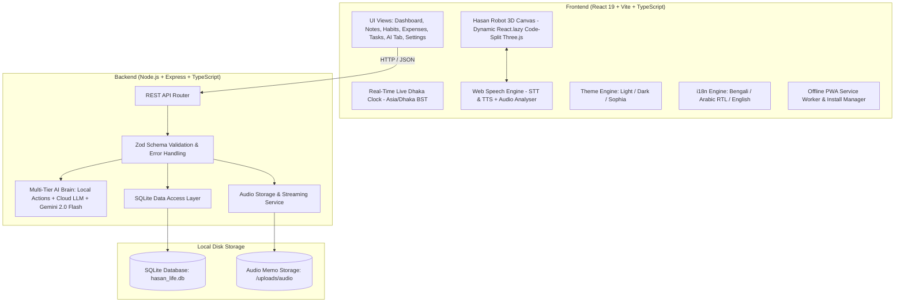

# Architecture & Technical Plan: Hasan Life Guide

## 1. System Architecture Diagram



---

## 2. Directory & Package Structure

```
hasan/
├── .spec/
│   ├── constitution.md
│   ├── spec.md
│   ├── plan.md
│   └── tasks.md
├── server/                    # Dedicated Backend Service
│   ├── src/
│   │   ├── config/            # Environment & database path config
│   │   ├── db/                # SQLite connection, migrations & schemas
│   │   │   ├── connection.ts
│   │   │   └── schema.sql
│   │   ├── controllers/       # Route handlers
│   │   │   ├── profileController.ts
│   │   │   ├── notesController.ts
│   │   │   ├── tasksController.ts
│   │   │   ├── habitsController.ts
│   │   │   ├── expensesController.ts
│   │   │   ├── aiController.ts
│   │   │   └── backupController.ts
│   │   ├── routes/            # Express API routes
│   │   ├── middleware/        # Uploads (multer), validation, error handler
│   │   ├── services/          # Local AI intent parser & Gemini client
│   │   └── index.ts           # Server entry point
│   ├── tests/                 # Comprehensive Backend API tests
│   │   ├── api.test.ts
│   │   └── db.test.ts
│   ├── uploads/               # Saved voice notes / audio files
│   ├── package.json
│   └── tsconfig.json
├── client/                    # React 18 + Vite Frontend (Phase 5+)
│   ├── src/
│   │   ├── components/
│   │   │   ├── mascot/        # 3D Hasan Robot & Lip-sync
│   │   │   ├── notes/         # Rich Note editor + Voice recorder
│   │   │   ├── dashboard/     # Personalized overview & briefing
│   │   │   ├── habits/        # Habits, Streaks & celebration
│   │   │   ├── expenses/      # Budget & Charts
│   │   │   └── shared/        # UI widgets, theme & language switchers
│   │   ├── i18n/              # Bengali, Arabic RTL, English locales
│   │   ├── themes/            # Dark, Light, Sophia definitions
│   │   └── services/          # Speech recognition & synthesis
│   └── package.json
└── package.json               # Root scripts (start, test, dev)
```

---

## 3. Database Schema (SQLite)

```sql
-- Profile and Settings
CREATE TABLE IF NOT EXISTS profile (
    id INTEGER PRIMARY KEY CHECK (id = 1),
    name TEXT NOT NULL DEFAULT 'Hasan',
    avatar_url TEXT,
    language TEXT NOT NULL DEFAULT 'bn', -- 'bn' | 'ar' | 'en'
    theme TEXT NOT NULL DEFAULT 'sophia', -- 'dark' | 'light' | 'sophia'
    gemini_api_key TEXT,
    mascot_enabled INTEGER NOT NULL DEFAULT 1,
    mascot_muted INTEGER NOT NULL DEFAULT 0,
    created_at DATETIME DEFAULT CURRENT_TIMESTAMP,
    updated_at DATETIME DEFAULT CURRENT_TIMESTAMP
);

-- Notes Table (Rich Text / Markdown)
CREATE TABLE IF NOT EXISTS notes (
    id TEXT PRIMARY KEY,
    title TEXT NOT NULL,
    content TEXT NOT NULL,
    tags TEXT DEFAULT '[]', -- JSON array of tags
    is_pinned INTEGER NOT NULL DEFAULT 0,
    color TEXT DEFAULT '#1E293B',
    created_at DATETIME DEFAULT CURRENT_TIMESTAMP,
    updated_at DATETIME DEFAULT CURRENT_TIMESTAMP
);

-- Voice Notes / Audio Memos (Attached to notes or standalone)
CREATE TABLE IF NOT EXISTS note_audio (
    id TEXT PRIMARY KEY,
    note_id TEXT,
    filename TEXT NOT NULL,
    filepath TEXT NOT NULL,
    duration_seconds REAL DEFAULT 0,
    file_size_bytes INTEGER DEFAULT 0,
    transcription TEXT,
    created_at DATETIME DEFAULT CURRENT_TIMESTAMP,
    FOREIGN KEY(note_id) REFERENCES notes(id) ON DELETE CASCADE
);

-- Tasks Table
CREATE TABLE IF NOT EXISTS tasks (
    id TEXT PRIMARY KEY,
    title TEXT NOT NULL,
    description TEXT,
    priority TEXT NOT NULL DEFAULT 'medium', -- 'low' | 'medium' | 'high'
    category TEXT DEFAULT 'general',
    due_date TEXT,
    is_completed INTEGER NOT NULL DEFAULT 0,
    created_at DATETIME DEFAULT CURRENT_TIMESTAMP,
    updated_at DATETIME DEFAULT CURRENT_TIMESTAMP
);

-- Habits Table
CREATE TABLE IF NOT EXISTS habits (
    id TEXT PRIMARY KEY,
    title TEXT NOT NULL,
    frequency TEXT NOT NULL DEFAULT 'daily', -- 'daily' | 'weekly'
    target_count INTEGER NOT NULL DEFAULT 1,
    color TEXT DEFAULT '#38BDF8',
    created_at DATETIME DEFAULT CURRENT_TIMESTAMP
);

-- Habit Logs (Tracking daily completions)
CREATE TABLE IF NOT EXISTS habit_logs (
    id TEXT PRIMARY KEY,
    habit_id TEXT NOT NULL,
    completed_date TEXT NOT NULL, -- YYYY-MM-DD
    created_at DATETIME DEFAULT CURRENT_TIMESTAMP,
    FOREIGN KEY(habit_id) REFERENCES habits(id) ON DELETE CASCADE,
    UNIQUE(habit_id, completed_date)
);

-- Expenses & Income
CREATE TABLE IF NOT EXISTS expenses (
    id TEXT PRIMARY KEY,
    title TEXT NOT NULL,
    amount REAL NOT NULL,
    type TEXT NOT NULL DEFAULT 'expense', -- 'expense' | 'income'
    category TEXT NOT NULL DEFAULT 'other',
    currency TEXT NOT NULL DEFAULT 'BDT',
    date TEXT NOT NULL, -- YYYY-MM-DD
    notes TEXT,
    created_at DATETIME DEFAULT CURRENT_TIMESTAMP
);
```

---

## 4. API Specification

| Endpoint | Method | Purpose | Payload / Parameters |
| :--- | :---: | :--- | :--- |
| `/api/health` | GET | Server health check & diagnostics | `{ status: "ok", uptime: number }` |
| `/api/profile` | GET / PUT | Fetch or update user profile, language & theme | `{ name, language, theme, gemini_api_key, ... }` |
| `/api/notes` | GET / POST | List notes (search/tags/pinned) or create new note | `{ title, content, tags, is_pinned, color }` |
| `/api/notes/:id` | GET / PUT / DELETE | Read, update or delete single note | `{ title, content, ... }` |
| `/api/notes/:id/audio` | POST | Upload audio recording attached to note | `multipart/form-data` with audio file |
| `/api/audio/:filename` | GET | Stream audio recording file | Audio stream (`audio/webm`, `audio/mp3`, `audio/wav`) |
| `/api/tasks` | GET / POST | List tasks or create task | `{ title, priority, category, due_date }` |
| `/api/tasks/:id` | PUT / DELETE | Update or delete task | `{ title, is_completed, ... }` |
| `/api/tasks/:id/toggle` | PATCH | Toggle task completion | `{ is_completed: boolean }` |
| `/api/habits` | GET / POST | List habits with streak calculation | `{ title, frequency, target_count, color }` |
| `/api/habits/:id/toggle` | POST | Log/unlog habit for given date | `{ date: "YYYY-MM-DD" }` |
| `/api/expenses` | GET / POST | List expenses with filters / create | `{ title, amount, type, category, currency, date }` |
| `/api/expenses/summary` | GET | Aggregated totals, category percentages | `{ month: "YYYY-MM" }` |
| `/api/ai/intent` | POST | Process local command or query | `{ prompt: string, language: string }` |
| `/api/backup/export` | GET | Download all user data in JSON format | Full database JSON payload |
| `/api/backup/import` | POST | Restore database from uploaded JSON | Validated backup JSON |

---

## 5. Technology Stack Decisions
1. **Backend Engine:** `Node.js` with TypeScript and Express. Provides rock-solid reliability, fast execution, native file/audio handling, and seamless cross-platform support on Windows.
2. **Database Engine:** `better-sqlite3` or SQLite driver with foreign key enforcement and transactional safety. 0 server overhead, lightning-fast (<2ms queries), stored in a single local file.
3. **Voice Audio Storage:** Express static file streaming with `multer` supporting standard web audio formats (`webm`, `mp3`, `wav`, `m4a`).
4. **Validation:** `zod` for strict request payload validation and type safety.
5. **Testing Framework:** Built-in Node test runner or `jest`/`supertest` with automated test suites verifying every single API route before proceeding.
